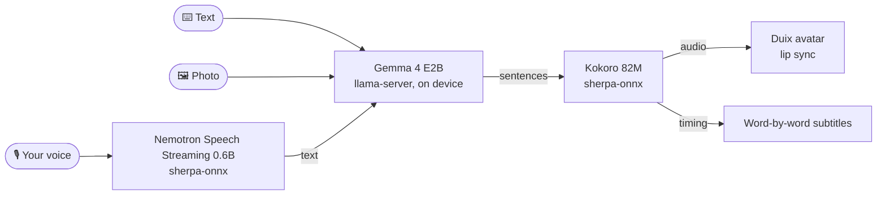

<p align="center">
  
</p>

<h1 align="center">PocketCompanion</h1>

<p align="center">
  <b>An offline AI avatar companion for Android.</b><br>
  A lip-synced, talking AI companion you chat with by voice, text or photo, running 100% on your phone.<br>
  No cloud. No account. No subscription.
</p>

<p align="center">
  <a href="https://github.com/SolvAI/PocketCompanion/releases/latest"></a>
  
  
  <a href="LICENSE"></a>
</p>

<table align="center">
  <tr>
    <td align="center" width="33%">
      <a href="https://solvai.github.io/PocketCompanion/media/voice.mp4"></a><br>
      <b>Talk to her</b><br><a href="https://solvai.github.io/PocketCompanion/media/voice.mp4">▶ Watch with sound</a>
    </td>
    <td align="center" width="33%">
      <a href="https://solvai.github.io/PocketCompanion/media/photo.mp4"></a><br>
      <b>Show her a photo</b><br><a href="https://solvai.github.io/PocketCompanion/media/photo.mp4">▶ Watch with sound</a>
    </td>
    <td align="center" width="33%">
      <a href="https://solvai.github.io/PocketCompanion/media/customize.mp4"></a><br>
      <b>Make her yours</b><br><a href="https://solvai.github.io/PocketCompanion/media/customize.mp4">▶ Watch with sound</a>
    </td>
  </tr>
</table>

<p align="center"><sub>Real screen recordings on a POCO X8 Pro, CPU only. The wait while she looks at the photo is fast-forwarded 6× (marked on screen) and an avatar-loading pause is cut.</sub></p>

PocketCompanion puts a private AI companion in your pocket. She sees you through photos, hears you
through the microphone and answers out loud, with a realistic avatar whose lips move with her voice.
Everything (the language model, speech recognition, the voice and the avatar) runs locally on your
phone's CPU. After a one-time model download, it works in airplane mode.

## Features

- **Talking avatar with lip sync.** 11 realistic digital humans by [duix.com](https://duix.com), rendered on device.
- **Local LLM.** Gemma 4 E2B (abliterated, Q4_K_M) through [llama.cpp](https://github.com/ggml-org/llama.cpp). Her reply starts streaming in about half a second.
- **Voice chat with live transcription.** Hold to talk: NVIDIA Nemotron streaming speech recognition shows what she understood while you are still speaking.
- **Natural voices.** 14 [Kokoro](https://huggingface.co/hexgrad/Kokoro-82M) voices: American, British, Japanese-accented and Mandarin-accented.
- **She understands photos.** Attach a picture and she reacts to what she sees (Gemma 4 vision).
- **Word-by-word subtitles.** Big, TikTok-style captions synced to her voice.
- **Make her yours.** Edit her instructions (system prompt) in Settings to change her personality. `{name}` becomes her name.
- **Private by design.** No account, no analytics, no server. Your conversations never leave the phone.

## Download

| Where | |
|---|---|
| **GitHub Releases** | [Latest APK](https://github.com/SolvAI/PocketCompanion/releases/latest) |

Install the APK (allow "install unknown apps" for your browser or file manager), open it, and tap
**Download and start**. The first start downloads about **5 GB** of models, so use Wi-Fi.

### Requirements

- Android 10 or newer, 64-bit ARM (arm64-v8a).
- 8 GB of RAM minimum, 12 GB recommended.
- About 6 GB of free storage.
- Tested on a POCO X8 Pro (MediaTek MT6899, 12 GB RAM, Android 16). Reports from other phones are welcome in [Issues](https://github.com/SolvAI/PocketCompanion/issues).

## How it works



- `llama-server` runs as a local process bound to `127.0.0.1` with a random API key, so only the app can reach it.
- Speech recognition decodes in 560 ms chunks while you talk; releasing the button sends the text right away.
- Each finished sentence is synthesized by Kokoro and pushed to the Duix engine, which computes mouth shapes for the audio and plays it.

## Performance

Measured on a POCO X8 Pro (4 + 4 core MediaTek MT6899, 12 GB RAM), CPU only:

| Step | Result |
|---|---|
| Cold start to ready (models already downloaded) | about 20 s |
| Speech recognition speed | 0.3-0.45x realtime; text ready 0.2-0.3 s after you let go |
| First reply text | 0.3-1.3 s |
| From your last word to her voice | about 4-5 s (most of it is synthesizing her first sentence) |
| Reply generation | about 9-13 tokens/s |
| Photo question, first reply text | about 10-13 s (photos are sent at 512 px) |
| Voice | Kokoro needs about 1-2 s of work per second of speech, so there are short pauses between sentences |

## Make her yours

Open **Settings** (the gear icon):

- **Companion:** pick one of 11 avatars (each downloads once, 45-410 MB).
- **Voice:** 14 voices in four accents.
- **Her instructions:** rewrite the system prompt. Saving starts a fresh conversation.

## Privacy

PocketCompanion has no backend, no account and no analytics. The only network traffic is the
one-time download of models from Hugging Face, GitHub and duix.com's public storage. After that
the app works fully offline.

## About the model

The default language model is an *abliterated* build of Gemma 4, meaning its refusals were removed,
so it answers more freely than a filtered assistant. Her instructions in Settings shape her
personality and what she talks about.

## Build from source

Requirements: JDK 17, Android SDK 34, NDK 25.1.8937393 and CMake 3.18.1 (the Duix avatar engine is
compiled from C++ source).

```bash
git clone https://github.com/SolvAI/PocketCompanion.git
cd PocketCompanion
./gradlew :app:assembleDebug        # app/build/outputs/apk/debug/PocketCompanion-<version>-debug.apk
./gradlew :app:testDebugUnitTest
```

Release builds are signed with a key read from `keystore.properties` (not in git).

Project layout:

| Path | What |
|---|---|
| `app/` | The PocketCompanion app (Kotlin): chat client, llama-server launcher, streaming ASR, Kokoro TTS, subtitles, settings |
| `duix-sdk/` | duix.com's Duix-Mobile avatar SDK 4.1.1 (C++ engine plus Java API), arm64 only |
| `app/src/main/jniLibs/` | llama.cpp b12224 android-arm64 libraries |
| `docs/` | The website, served by GitHub Pages |

Debug builds accept adb intents for testing without touching the screen, for example
`adb shell am start -n io.github.solvai.pocketcompanion/.CompanionActivity --es say "hello"`.
See `CompanionActivity.onNewIntent` for the full list.

## FAQ

**Is this an offline alternative to Character.AI or Replika?**
It covers similar ground (a companion with a personality you can talk to) but everything runs on
your phone and nothing is sent to a server. It has no memory between conversations yet.

**Does it need a GPU or NPU?**
No. Everything runs on the CPU. GPU and NPU acceleration are on the roadmap.

**Can I use another model?**
Yes, if llama.cpp supports it: change `MODEL_FILE`, `MODEL_URL` and the projector constants in
`CompanionActivity.kt` and rebuild.

**Which languages does it speak?**
Conversations are in English. The voices offer American, British, Japanese and Mandarin accents.

## Roadmap

- GPU (Vulkan/OpenCL) or NPU acceleration
- Long-term memory across conversations
- More languages for speech recognition and voices
- Bring your own avatar

## Credits and license

**Powered by Duix.com.** The avatar engine and stock avatars are from
[Duix-Mobile](https://github.com/duixcom/Duix-Mobile), under the
[duix.com Community License](duix-sdk/LICENSE.md). It requires a separate license from duix.com for
products above 1,000 monthly active users.

Demo photo: "Monument valley" by OrbiteLambda,
[CC BY-SA 4.0](https://creativecommons.org/licenses/by-sa/4.0/), from the Ubuntu wallpapers.

Also built on [llama.cpp](https://github.com/ggml-org/llama.cpp),
[sherpa-onnx](https://github.com/k2-fsa/sherpa-onnx),
[Gemma 4](https://huggingface.co/google/gemma-4-E2B-it) (abliterated by
[huihui-ai](https://huggingface.co/huihui-ai), quantized by [mradermacher](https://huggingface.co/mradermacher)),
[Kokoro](https://huggingface.co/hexgrad/Kokoro-82M) and
[NVIDIA Nemotron Speech Streaming](https://huggingface.co/nvidia/nemotron-speech-streaming-en-0.6b).
Full list in [THIRD_PARTY_NOTICES.md](THIRD_PARTY_NOTICES.md).

PocketCompanion's own code is [MIT licensed](LICENSE). Changes are listed in [CHANGELOG.md](CHANGELOG.md).
